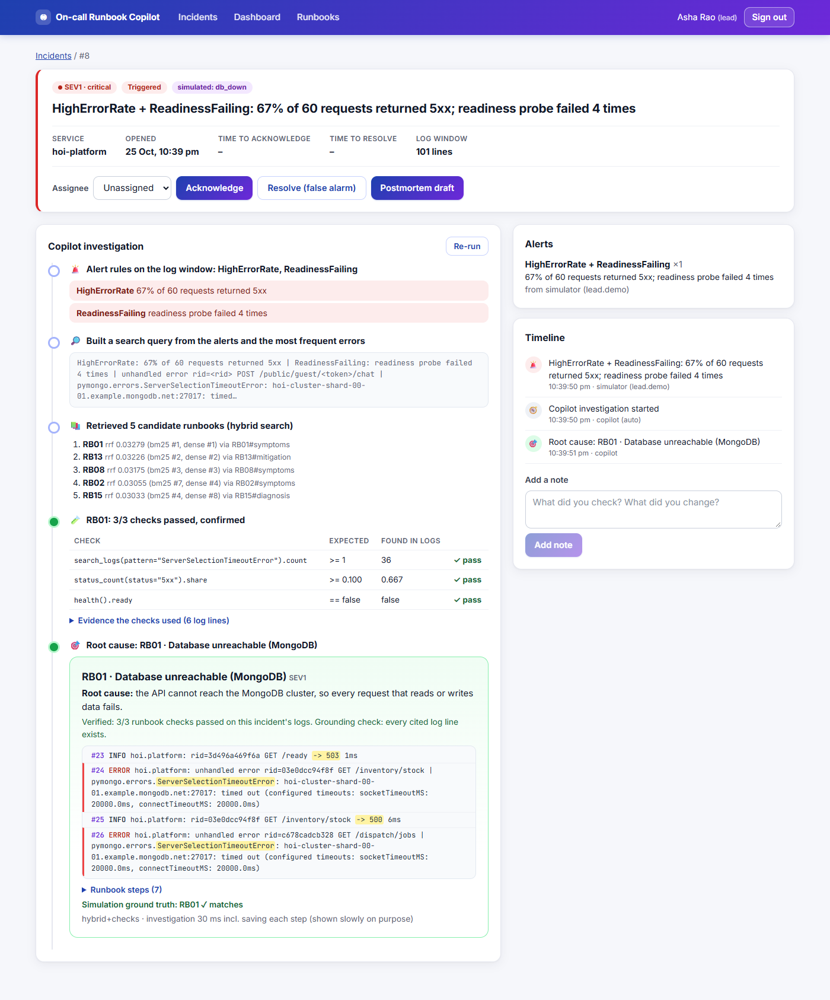
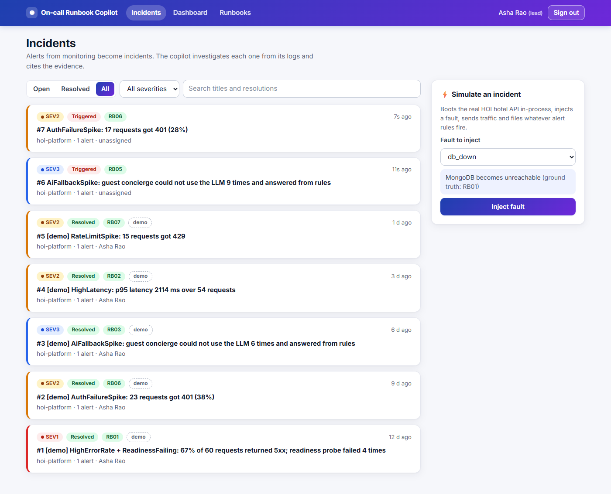
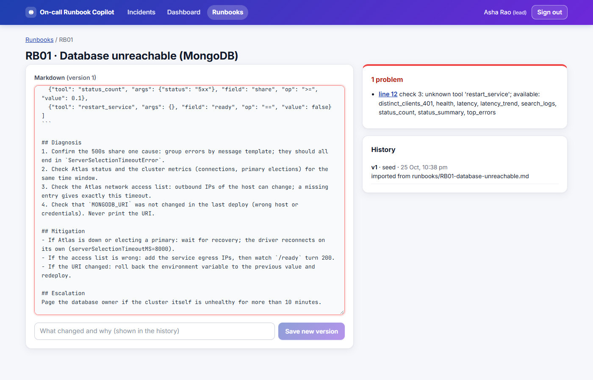
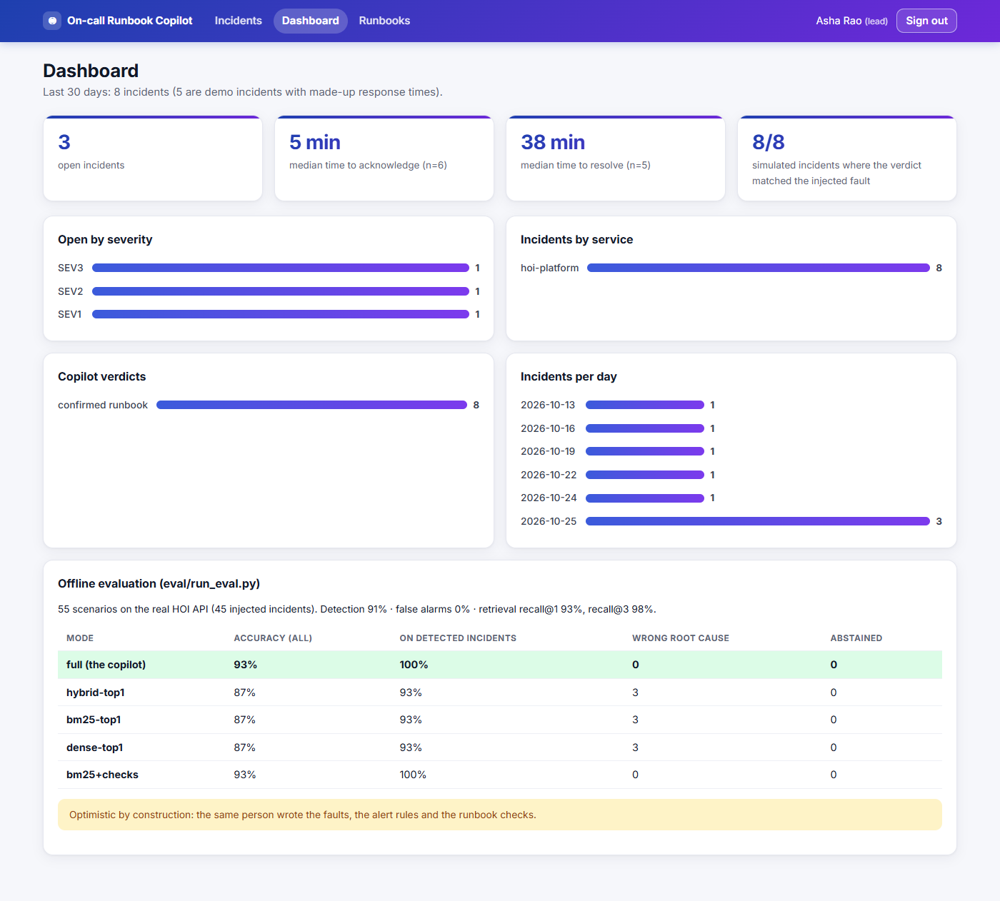
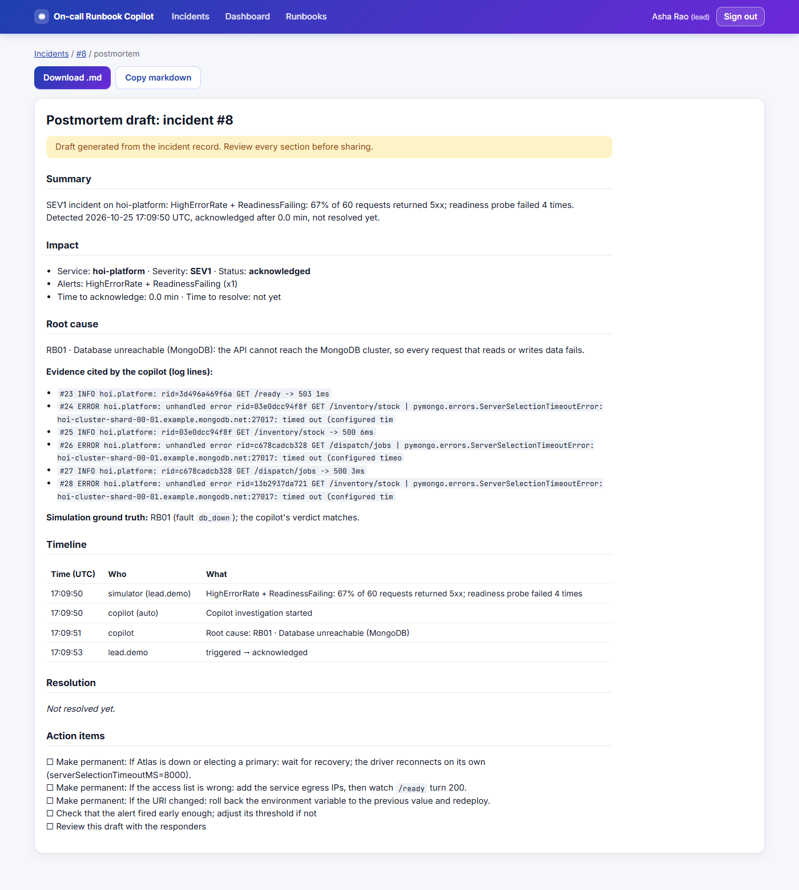
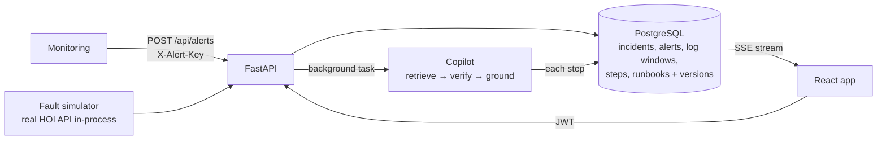

# On-call Runbook Copilot

An incident-response web app for the [HOI platform API](https://github.com/Ashu-Stark/Hospitality-). Alerts become
incidents; for each one the copilot **retrieves the matching runbook, proves the root cause from the service's own logs
and cites the log lines**, or says **UNKNOWN** and escalates instead of guessing. Engineers acknowledge, assign, take
notes, edit runbooks and get a postmortem draft built from the incident record.

React + TypeScript · FastAPI · PostgreSQL (SQLAlchemy 2, Alembic) · Server-Sent Events · JWT + bcrypt · Docker · GitHub Actions

**[Live incident gallery →](https://ashu-stark.github.io/oncall-copilot/)** (static, one real incident note per fault type)
· **[Full documentation (PDF)](docs/On-call_Runbook_Copilot_Documentation.pdf)**



| Inbox and fault simulator | Runbook editor with live validation |
|---|---|
|  |  |
| **Dashboard** | **Postmortem draft** |
|  |  |

## What it does

- **Alerts → incidents, deduplicated.** `POST /api/alerts` (monitoring sends `X-Alert-Key`) opens an incident; the same
  fingerprint while that incident is open only bumps a counter. A partial unique key (`open_fingerprint`) makes this
  hold even when identical alerts arrive at the same moment (tested with 8 parallel requests).
- **Live investigation.** The copilot runs as a background task; every step (alert rules, query, retrieved runbooks,
  each runbook's checks with pass/fail and evidence, verdict) is stored in Postgres and streamed to the browser over
  Server-Sent Events. The stream resumes after a dropped connection (`Last-Event-ID`).
- **Verified verdicts.** A runbook is confirmed only when all its checks pass on this incident's logs; every cited log
  line must exist. Otherwise the verdict is "abstained: escalate to a human".
- **Workflow.** triggered → acknowledged → investigating → resolved (a false alarm can be resolved directly; resolved
  is final). Assignee, notes, and a timeline of everything that happened. MTTA/MTTR are computed from the timestamps.
- **Runbook library in Postgres.** Same markdown format as `runbooks/*.md`, edited in the browser with live validation
  of the checks DSL (unknown tools, bad arguments, invalid JSON with its line number), version history, and optimistic
  locking (a stale edit gets 409, not a silent overwrite). The next investigation uses the new version.
- **Fault simulator.** Boots the real HOI API in-process, injects one of the evaluation's faults, sends traffic and files
  whatever alert rules fire. Simulated incidents carry their ground truth, so the UI shows whether the verdict matched.
- **Postmortem draft** generated from the record (summary, impact, root cause with evidence, timeline, action items).
  An optional server-side LLM can rewrite the summary paragraph; no key ever reaches the browser.
- **Security:** bcrypt passwords, JWT sessions (8 h), roles (engineer / lead: only leads change runbooks), login throttle
  (5 failures per minute per user), constant-time alert-key check, request IDs, `/api/metrics`.



How an incident is investigated: its stored log window is loaded back into the copilot's own log store (so cited ids are
the incident's line numbers), the readiness probe captured with the alert is replayed to the `health` tool, and
`copilot.agent.investigate` runs unchanged with an observer that records each step. A test runs all 9 faults both ways
(live HOI vs stored-and-replayed) and checks that the verdict and the cited log ids are identical.

## Run it

**Without Docker** (Python 3.12, Node 22; Postgres is started for you by `pgserver`):

```powershell
python -m venv .venv; .venv\Scripts\activate
pip install -r backend/requirements.txt
$env:DATABASE_URL = python backend/devdb.py          # embedded Postgres in .pgdata/, keeps running
alembic -c backend/alembic.ini upgrade head
python -m backend.app.seed --demo-incidents          # demo users, 16 runbooks, 5 demo incidents
$env:DEMO_MODE="true"; $env:DEMO_PASSWORD="oncall-demo-2026"
uvicorn backend.app.main:app --port 8104             # API (from the repo root)
cd frontend; npm install; npm run dev                # http://localhost:5184
```

The fault simulator needs the HOI repo next to this one (`../INNOV8/platform_api`) or `HOI_PLATFORM_PATH`.

**With Docker:** `cp .env.example .env`, fill it in, `docker compose up --build`, open http://localhost:8080. The API image
clones HOI at a pinned commit for the simulator. **Render:** `render.yaml` creates Postgres, the API and the static site.

Demo accounts (seeded): `lead.demo` (can edit runbooks) and `engineer.demo`. Demo incidents are real simulations whose
acknowledge/resolve times are made up and backdated so the dashboard has history; they are marked **demo** everywhere.

## Tests

```powershell
python -m pytest -q tests            # 11 copilot unit tests
python -m pytest -q backend/tests    # 37 web-app tests against real Postgres
cd frontend; npm test                # 15 UI tests (Testing Library + axe-core)
```

Backend tests cover authentication and roles, the login throttle, alert dedup (including 8 parallel identical alerts),
the status workflow, MTTA/MTTR, stored investigation steps and abstention, the SSE stream and resume, runbook validation
and versioning, a new runbook changing the next verdict, the simulator, and live-vs-replayed equivalence for 9 faults.
CI (`.github/workflows/ci.yml`) runs them with a Postgres service container.

## API

| Method | Path | What |
|---|---|---|
| POST | `/api/auth/login` | Username + password → JWT |
| POST | `/api/alerts` | Ingest an alert (optional log window and health probe); dedup by fingerprint |
| GET | `/api/incidents` | Filter by status, severity, service, text; paginated |
| GET | `/api/incidents/{id}` · `/timeline` · `/logs` | Detail, timeline, log lines by id |
| PATCH | `/api/incidents/{id}/status` · `/assignee` | Workflow transitions (409 on invalid), assignment |
| POST | `/api/incidents/{id}/notes` · `/investigations` | Add a note; re-run the copilot |
| GET | `/api/investigations/{id}` · `/stream` | Steps and verdict; SSE stream |
| GET | `/api/incidents/{id}/postmortem` | Postmortem draft (markdown) |
| GET/POST/PUT | `/api/runbooks` · `/validate` · `/{id}/versions/{v}` | Library, validation, create/edit (lead), history |
| GET/POST | `/api/simulator` · `/run` | Available faults; inject one |
| GET | `/api/dashboard` · `/api/metrics` · `/api/health` | Aggregates, request metrics, liveness |

## The copilot


- **Real system, real logs.** Faults are injected by swapping the dependencies HOI already isolates (MongoDB accessors,
  the LLM adapter, the portal HTTP client, settings). HOI's code is not modified, so the copilot sees exactly the log
  lines HOI writes (`rid=... GET /rooms -> 500 4ms`, `ServerSelectionTimeoutError`, `concierge fallback to rules: llm
  call failed (HTTP 429)`).
- **Retrieval narrows, evidence decides.** 7 of the 16 runbooks are near-misses: a slow database vs a cold start (both
  high latency), a rotated JWT secret vs password guessing vs normal token expiry (all 401s). Retrieval picks by wording;
  the checks separate them by evidence (is the slowness only at the start? are the 401s on `/auth/login` or everywhere?).
- **Abstain rather than guess**, and **read-only**: the copilot never restarts or changes anything.
- A tourism-portal outage produces no user impact (HOI serves its own place list and a cache), so the right answer is
  "no incident", and both the eval and the simulator treat it that way.

Command line (no web app): `python demo.py db_down`, `python demo.py --list`, `python eval/run_eval.py`,
`python site/build_site.py` (rebuilds the static gallery in `docs/`).

| Path | What |
|---|---|
| `copilot/` | Log store, read-only tools, alert rules, runbook parser, BM25 + LSA + RRF retrieval, investigator, LLM investigator |
| `harness/` | Runs HOI in-process, generates traffic, injects 10 fault types |
| `runbooks/` | 16 runbooks (9 for injected faults, 7 near-miss distractors); seeded into Postgres |
| `eval/` | Evaluation script and results |
| `backend/app/` | FastAPI app: models, alert dedup and workflow, investigations + SSE, runbook store, simulator, postmortem |
| `backend/migrations/` | Alembic migrations |
| `frontend/src/` | React app: inbox, incident page with live stream, runbooks editor, dashboard, postmortem |

## Results (offline evaluation, unchanged by the web app)

55 scenarios (11 types × 5 variants with different seeds, fault strength and background noise): 45 injected incidents,
10 with no incident. Full table: [eval/results.md](eval/results.md).

| Metric | Value |
|---|---|
| False-alarm rate (no incident, but an alert fired) | 0 / 10 |
| Detection rate (an alert fired for an incident) | 41 / 45 (91%) |
| Retrieval recall@1 / @3 (hybrid, detected incidents) | 93% / 98% |

| Mode | Correct (all 55) | Correct (41 detected) | Wrong root cause |
|---|---|---|---|
| **Copilot: hybrid retrieval + log-verified checks** | **93%** | **100%** | **0** |
| Hybrid retrieval, top-1, no verification | 87% | 93% | 3 |
| BM25 only, top-1 | 87% | 93% | 3 |
| LSA vectors only, top-1 | 87% | 93% | 3 |
| BM25 + verification | 93% | 100% | 0 |

- **Verification is what removes wrong answers** (3 to 0).
- **Dense retrieval adds nothing here** (BM25 + checks is as good): 16 short runbooks full of exact error names suit keywords.
- **All 4 misses are detection misses**, not wrong diagnoses (weak password guessing and a mild rate-limit change that
  never tripped an alert).
- The LLM investigator (`--llm`) is implemented but **not yet evaluated**; no numbers are claimed for it.

## Limitations (read before quoting numbers)

- **Optimistic by construction.** The same person wrote the faults, the alert rules and the runbook checks. The numbers
  show the pipeline works end to end on a real codebase and how its parts compare; they are not an accuracy estimate for
  unseen production incidents.
- Faults are single and clean; real incidents overlap. Traffic is about 60 requests per scenario from one process.
- The web app runs one API process: the simulator changes process-wide state (so simulations run one at a time) and the
  SSE stream polls Postgres every 250 ms; several instances would need `LISTEN/NOTIFY` or a queue and a separate worker.
- Alert ingestion takes a log window with the alert; a real deployment would pull logs from the log platform instead.
- Investigation steps are deliberately paced (`STEP_DELAY_MS`, default 350 ms) so people can follow them; the copilot's
  own time is shown separately.
- The demo dashboard's MTTA/MTTR include the made-up times of the 5 demo incidents.

## Things to be ready to explain

- Why a partial unique key, not a "check then insert", makes alert dedup safe under concurrency.
- How the SSE stream works with an `Authorization` header (fetch + stream parser, not `EventSource`) and how it resumes.
- Why the copilot's verdict from stored logs equals the live one (same ids, replayed health probe), and how that is tested.
- Optimistic locking on runbook edits (`base_version`, 409) vs locking a row while someone edits.
- Why runbook checks can only call read-only tools, and how the validator enforces that.
- What MTTA/MTTR measure, and why demo data must be labelled.
