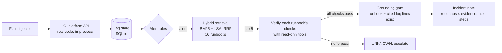

# On-call Runbook Copilot for HOI

**[Live incident gallery →](https://ashu-stark.github.io/oncall-copilot/)** one real incident note per fault type, produced by running the copilot against the HOI API.



An on-call assistant for the [HOI platform API](https://github.com/Ashu-Stark/Hospitality-): when an alert fires it
retrieves the matching runbook, **checks the runbook's claims against the service's own logs**, and writes an incident
note with the root cause, the log lines that prove it, and the next steps. If nothing is confirmed by the logs it says
**UNKNOWN** and escalates instead of guessing.

It is evaluated by injecting real faults into the real HOI codebase (run in-process on an in-memory database) and
checking whether the copilot names the true root cause.

```
fault injector ──► HOI platform API ──► log store (SQLite) ──► alert rules
                                                                    │
                                    ┌───────────────────────────────┘
                                    ▼
             hybrid retrieval over 16 runbooks (BM25 + LSA vectors, Reciprocal Rank Fusion)
                                    │ top 5
                                    ▼
             verify: run each runbook's checks with read-only tools (status counts, latency, log search, health)
                                    │ first runbook whose checks all pass, else UNKNOWN
                                    ▼
             grounding gate: runbook must exist, every cited log id must exist ──► incident note
```

## Why it is built this way

- **Real system, real logs.** Faults are injected by swapping the dependencies HOI already isolates (MongoDB accessors,
  the LLM adapter, the portal HTTP client, settings). HOI's code is not modified, so the copilot sees exactly the log
  lines HOI writes in production (`rid=... GET /rooms -> 500 4ms`, `ServerSelectionTimeoutError`, `concierge fallback to
  rules: llm call failed (HTTP 429)`).
- **Retrieval narrows, evidence decides.** Similar-looking incidents are the hard part: a slow database vs a cold start
  (both high latency), a rotated JWT secret vs password guessing vs normal token expiry (all 401s), a rate limit set too
  low vs an attack (both 429). 7 of the 16 runbooks are such near-misses. Retrieval alone picks by wording; the checks
  separate them by evidence (is the slowness only at the start? are the 401s on `/auth/login` or everywhere?).
- **Abstain rather than guess.** A wrong root cause at 3 a.m. costs more than "I don't know".
- **Read-only.** The copilot never restarts, rolls back or changes anything; a human applies the fix.
- **The demo hotel taught one case:** a tourism-portal outage produces no log signal at all, because HOI serves the
  hotel's own place list and a cache first. The right answer there is "no incident", and the eval scores it that way.

## Run

```powershell
# uses the HOI repo's virtualenv (FastAPI, mongomock, scikit-learn already installed)
..\INNOV8\.venv\Scripts\python.exe demo.py --list
..\INNOV8\.venv\Scripts\python.exe demo.py db_down
..\INNOV8\.venv\Scripts\python.exe -m pytest -q tests
..\INNOV8\.venv\Scripts\python.exe eval\run_eval.py           # ~55 scenarios, a few minutes
..\INNOV8\.venv\Scripts\python.exe site\build_site.py         # rebuilds the live gallery in docs/
$env:GROQ_API_KEY="..."; ..\INNOV8\.venv\Scripts\python.exe eval\run_eval.py --llm   # adds the LLM investigators
```

`HOI_PLATFORM_PATH` points at HOI's `platform_api` folder (default `../INNOV8/platform_api`).

## Layout

| Path | What |
|---|---|
| `copilot/logstore.py` | SQLite log store; parses HOI access lines into status / latency / path columns |
| `copilot/tools.py` | Read-only tools: status counts, latency and trend, 401 spread, log search, top errors, health |
| `copilot/alerts.py` | Alert rules (what is wrong) |
| `copilot/runbooks.py` | Runbook parser: sections for retrieval, a JSON `checks` block for verification |
| `copilot/retrieval.py` | BM25 (hand-written), LSA vectors, Reciprocal Rank Fusion |
| `copilot/agent.py` | Runbook-guided investigator, grounding gate, incident note |
| `copilot/llm_agent.py` | LLM investigator with function calling (OpenAI-compatible: Groq, OpenAI, Ollama) |
| `harness/` | Runs HOI in-process, generates traffic, injects 10 fault types |
| `runbooks/` | 16 runbooks (9 for injected faults, 7 near-miss distractors) |
| `eval/` | Evaluation script and results |

## Results

55 scenarios (11 types x 5 variants with different seeds, fault strength and background noise): 45 injected incidents,
10 with no incident (healthy traffic, and a portal outage HOI absorbs). Full table: [eval/results.md](eval/results.md).

| Metric | Value |
|---|---|
| False-alarm rate (no incident, but an alert fired) | 0 / 10 |
| Detection rate (an alert fired for an incident) | 41 / 45 (91%) |
| Retrieval recall@1 / @3 (hybrid, detected incidents) | 93% / 98% |

| Mode | Correct (all 55) | Correct (41 detected) | Wrong root cause |
|---|---|---|---|
| **Copilot: hybrid retrieval + log-verified checks** | **93%** | **100%** | **0** |
| Hybrid retrieval, top-1, no verification | 87% | 93% | 3 |
| BM25 only, top-1 | 87% | 93% | 3 |
| LSA vectors only, top-1 | 87% | 93% | 3 |
| BM25 + verification | 93% | 100% | 0 |

What this says:
- **Verification is what removes wrong answers** (3 to 0). Retrieval by wording alone confused the near-miss pairs.
- **Dense retrieval adds nothing here** (BM25 + checks is as good). With 16 short runbooks full of exact error names,
  keywords win; dense search should matter with paraphrased alerts or many more runbooks.
- **All 4 misses are detection misses**, not wrong diagnoses: 8 and 12 password guesses stay under the login limit
  (10 per minute) so HOI never returns 429, and a guest-chat limit of 5 or 8 per minute was not hit by this traffic.
  Arguably correct (nothing user-visible happened), counted as misses anyway.
- The LLM investigator (`--llm`) is implemented but **not yet evaluated**; no numbers are claimed for it.

## Limitations (read before quoting numbers)

- **Optimistic by construction.** The same person wrote the faults, the alert rules and the runbook checks. The numbers
  show that the pipeline works end to end on a real codebase and how its parts compare; they are not an accuracy
  estimate for unseen production incidents.
- Faults are single and clean; real incidents overlap (a slow database that then times out).
- Traffic is about 60 requests per scenario from one process; thresholds are set for that scale.
- LSA vectors are learned from 16 runbooks only; a pretrained sentence-embedding model would generalise better and can
  be plugged in through `Embedder`.
- All HOI data is synthetic (fictional demo hotel).
